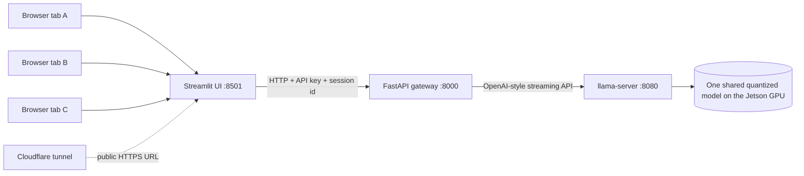
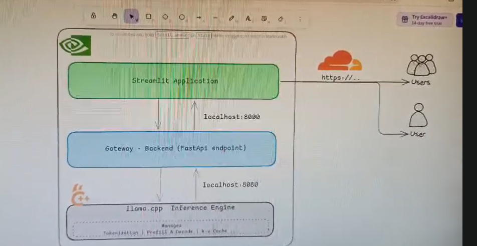
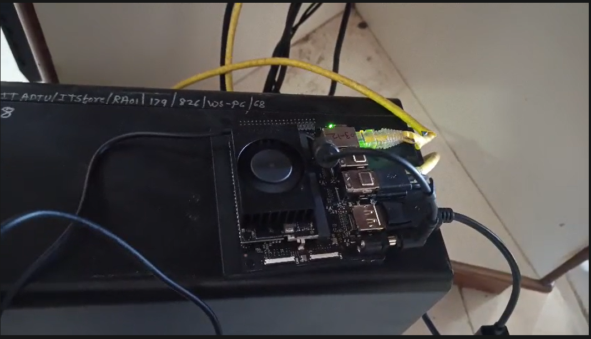
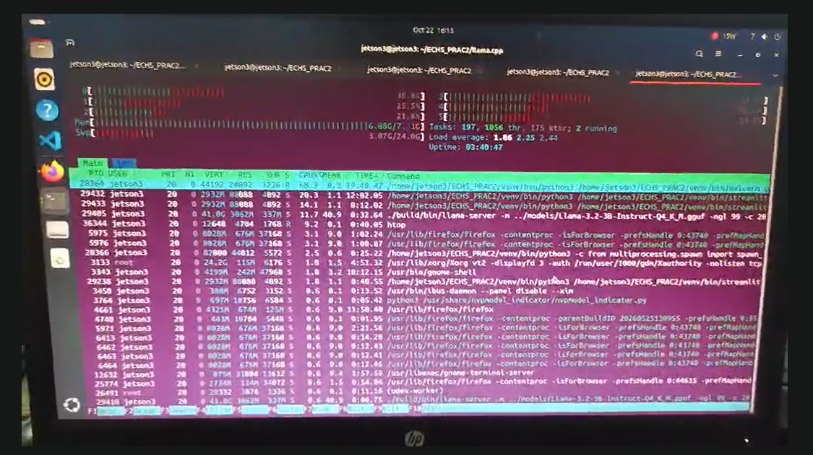
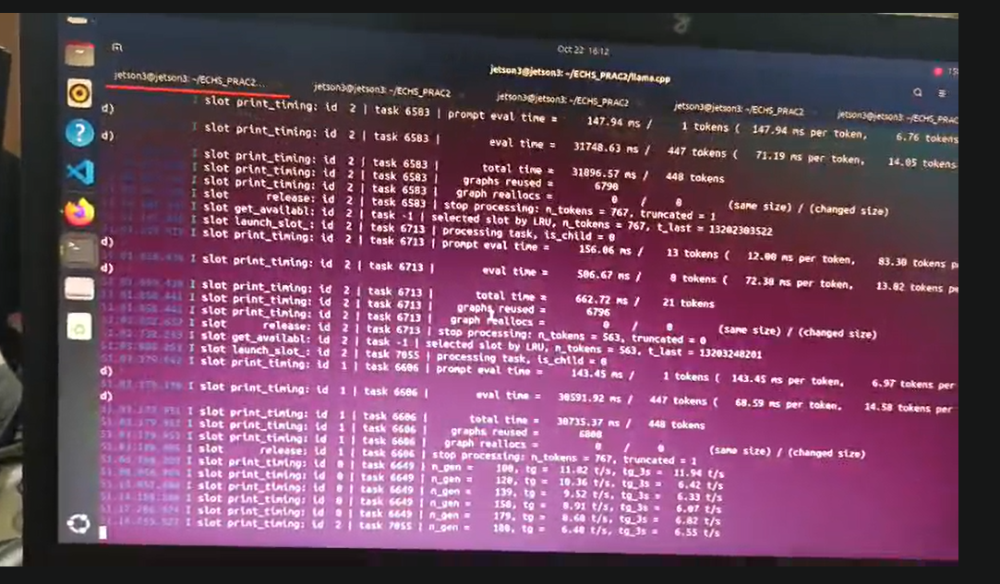
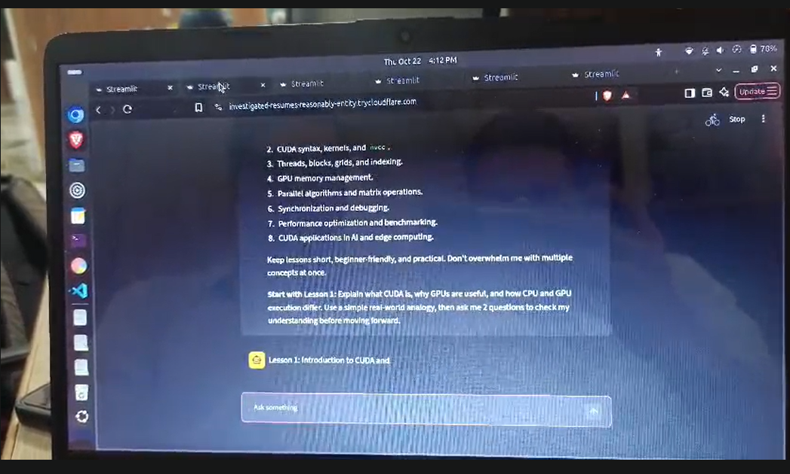
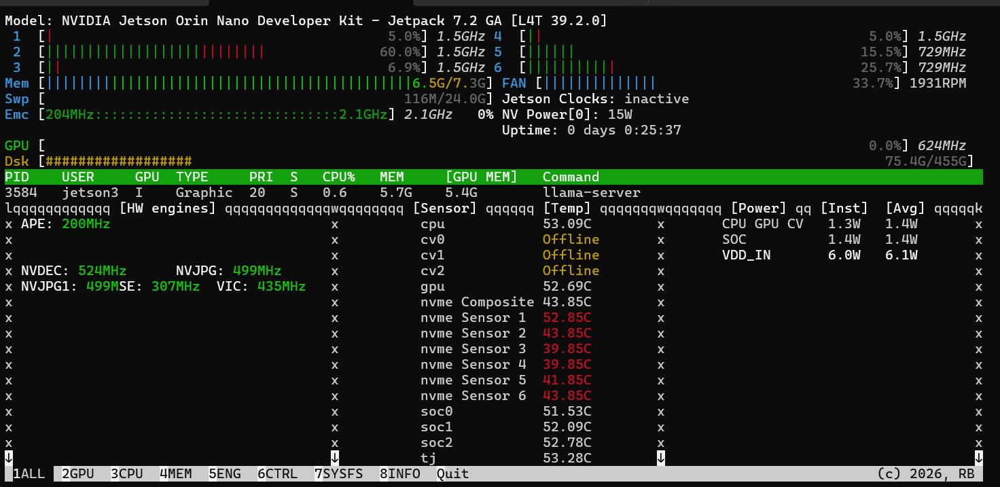

# Jetson Edge LLM Chat

**A multi-user, locally hosted LLM chatbot running on an NVIDIA Jetson Orin Nano 8 GB.**
One quantized Llama model is loaded once and shared by every user. A FastAPI gateway
handles access control and limits, a Streamlit page provides the chat interface, and a
Cloudflare tunnel can publish it to the internet. Inference happens on the board: no cloud
model API is involved.

> **Project:** EdgeAI: Multi-User Local LLM Inference and Serving System Using NVIDIA Jetson
> See [`docs/PROBLEM_STATEMENT.md`](docs/PROBLEM_STATEMENT.md) for the motivation and objectives.

---

## Contents

1. [What it does](#what-it-does)
2. [Architecture](#architecture)
3. [Tech stack](#tech-stack)
4. [Hardware and verified environment](#hardware-and-verified-environment)
5. [Project status](#project-status)
6. [Repository structure](#repository-structure)
7. [Quick start](#quick-start)
8. [Model profiles](#model-profiles)
9. [Configuration](#configuration)
10. [API reference](#api-reference)
11. [Testing](#testing)
12. [Benchmarking](#benchmarking)
13. [Execution evidence (screenshots and video)](#execution-evidence-screenshots-and-video)
14. [Memory and performance notes](#memory-and-performance-notes)
15. [Security](#security)
16. [Troubleshooting](#troubleshooting)
17. [Limitations and future work](#limitations-and-future-work)
18. [Acknowledgements](#acknowledgements)

---

## What it does

- Serves a quantized **Llama 3.2 3B Instruct** (and optionally **Llama 3.1 8B Instruct**) from a Jetson Orin Nano using **llama.cpp** with CUDA.
- Lets **several people chat at once** through a browser. Each browser tab has its own session and its own history.
- Uses llama.cpp's **parallel slots** and **continuous batching** so concurrent requests share one copy of the model weights. Extra requests wait in a queue.
- Streams tokens to the browser as they are generated.
- Protects the endpoint with an **API key**, a **per-session rate limit**, a **cap on requests in flight** (HTTP 429 when busy), and **input clamping**.
- Logs one line per request (request id, time to first token, tokens, duration).
- Includes a **benchmark tool**, a **mock model server** for testing without a GPU, helper scripts, and optional **systemd** units.

## Architecture



Original design sketch (drawn before building; the layers and ports match the final system):



| Layer | Port | Exposed to | Job |
|---|---|---|---|
| Streamlit (`frontend/app.py`) | 8501 | Users (directly on the LAN, or through the tunnel) | Chat page, per-tab session state, streaming display |
| FastAPI (`gateway/main.py`) | 8000 | Localhost only | API key, rate limit, queue cap, trimming, token relay, logging |
| llama-server (llama.cpp) | 8080 | Localhost only | Scheduling, continuous batching, KV cache, GPU inference |

**How a reply gets back to the right user:** each request keeps its own open HTTP connection
all the way down the chain (browser, Streamlit, gateway, llama-server). Tokens are written
back on that same connection, so nothing has to be looked up by id afterwards. Inside
llama-server a request becomes a task, is assigned a free slot, and its tokens are sent to
its own connection. A slot is temporary and does not belong to a user, which is why the UI
sends recent history with every message. Details in [`docs/ARCHITECTURE.md`](docs/ARCHITECTURE.md).

## Tech stack

| Area | Technology |
|---|---|
| Hardware | NVIDIA Jetson Orin Nano 8 GB Developer Kit |
| OS | Ubuntu 24.04 (JetPack 7.2, L4T 39.2.0) |
| Inference | llama.cpp (`llama-server`), CUDA build, GGUF models, Q4_K_M quantization |
| Models | Llama 3.2 3B Instruct, Llama 3.1 8B Instruct |
| Backend | Python 3.12, FastAPI, Uvicorn, httpx |
| Frontend | Streamlit |
| Public access | Cloudflare Tunnel (`cloudflared`) |
| Monitoring | `tegrastats`, `jtop` |

## Hardware and verified environment

Values below were read from the device (jtop screenshot and terminal output on 22 Oct 2026).

| Item | Value |
|---|---|
| Board | NVIDIA Jetson Orin Nano Developer Kit |
| JetPack / L4T | JetPack 7.2 GA / L4T 39.2.0 |
| OS / kernel | Ubuntu 24.04.4 LTS / 6.8.12-1021-tegra (aarch64) |
| Memory | about 7.3 GiB, shared between CPU and GPU |
| Swap | about 24 GiB (`/ssd/16GB.swap` and `/swapfile`) |
| Power mode seen | NV Power mode 0, 15 W; Jetson Clocks inactive |
| Idle with a model loaded | about 6 W board power, about 53 C, fan about 34% |



> Swap is **not** extra GPU memory. CUDA allocations on Jetson cannot be paged to disk, so swap
> only protects the rest of the system. See [Memory and performance notes](#memory-and-performance-notes).

## Project status

Be explicit about what is proven and what is not. "Observed" means it is visible in the photos under
[Execution evidence](#execution-evidence-screenshots-and-video), taken on 22 Oct 2026.

| Item | Status |
|---|---|
| llama.cpp built with CUDA; Llama 3.2 3B Q4_K_M served with `-ngl 99` and a small context | **Confirmed on the device.** The `llama-server` command line is visible in htop |
| Several slots working at once | **Observed.** The llama-server log shows slots `id 0`, `id 1` and `id 2` each handling separate tasks (see the slot-log photo). The exact flags of that run are not readable in the photo; add them to the table in [Observed results](#observed-results-from-the-photos) |
| Public access through Cloudflare | **Observed.** The chat page loads in a browser from a `trycloudflare.com` address and streams a reply |
| Gateway (FastAPI) and Streamlit UI running together with llama.cpp | **Observed** in htop (uvicorn and Streamlit processes next to `llama-server`). That was the first working deployment |
| `-c 16384 --parallel 4` for the 3B | **Failed on the device** with a CUDA out-of-memory error while allocating the KV cache (about 952 MiB) |
| The cleaned-up gateway, UI, benchmark tool and smoke tests in this repository | **Tested against the bundled mock model server** (concurrency, queueing, 429 busy, rate limit, 401/422, 503 when the model is down, disconnect cleanup, per-tab sessions, password gate). **Still to run on the Jetson with the real model** |
| Controlled benchmark (TTFT, per-user and total tokens/s, peak memory) | **To measure** (see [Benchmarking](#benchmarking)) |
| 8B model | **To test.** The model file is present; memory is very tight |

## Repository structure

```text
jetson-edge-llm-chat/
├── README.md
├── requirements.txt            Python dependencies
├── .env.example                Settings template (copy to .env)
├── .gitignore                  Keeps models, venv, secrets and logs out of git
├── gateway/
│   └── main.py                 FastAPI gateway
├── frontend/
│   └── app.py                  Streamlit chat UI
├── benchmarks/
│   └── bench.py                Concurrency benchmark (TTFT, tokens/s, errors, CSV output)
├── tests/
│   ├── mock_llama.py           Fake llama-server for testing without a GPU
│   └── smoke_test.py           End-to-end checks against a running gateway
├── scripts/
│   ├── start_llama_server.sh   Start llama-server by profile (3b-1slot, 3b-2slot, ...)
│   ├── start_gateway.sh        Start FastAPI
│   ├── start_frontend.sh       Start Streamlit
│   ├── setup_venv.sh           Create venv and install packages (with long timeouts)
│   ├── install_cloudflared.sh  Download and install cloudflared with checks
│   ├── start_tunnel.sh         Publish the UI with a Cloudflare quick tunnel
│   ├── check_env.sh            Read-only status of the board and the stack
│   ├── monitor.sh              Log tegrastats to logs/
│   └── collect_evidence.sh     Save system state and sample output to docs/evidence/
├── deploy/systemd/             Optional units to start everything at boot
├── docs/
│   ├── ARCHITECTURE.md
│   ├── PROBLEM_STATEMENT.md
│   ├── TROUBLESHOOTING.md
│   ├── GITHUB_PUSH.md
│   ├── EVIDENCE_CHECKLIST.md
│   ├── screenshots/            Put your screenshots here
│   └── evidence/               Text output saved by collect_evidence.sh
├── models/                     GGUF files go here (git-ignored)
└── logs/                       Runtime logs (git-ignored)
```

## Quick start

These steps assume the folder layout already used on the board: `~/ECHS_PRAC2` containing
`llama.cpp/`, `models/` and `venv/`, with this project in `~/ECHS_PRAC2/jetson-edge-llm-chat`.
If your paths differ, set them in `.env` (`LLAMA_CPP_DIR`, `MODELS_DIR`, `VENV_DIR`).

**1. Get the code and install packages**

```bash
cd ~/ECHS_PRAC2
git clone https://github.com/<Ula45>/jetson-edge-llm-chat.git
cd jetson-edge-llm-chat
./scripts/setup_venv.sh        # uses long timeouts because PyPI can be slow from the Jetson
```

**2. Build llama.cpp with CUDA** (skip if `llama.cpp/build/bin/llama-server` already exists)

```bash
cd ~/ECHS_PRAC2
git clone https://github.com/ggml-org/llama.cpp && cd llama.cpp
cmake -B build -DGGML_CUDA=ON -DCMAKE_CUDA_ARCHITECTURES=87
cmake --build build --config Release -j4
```

**3. Get the models** (skip if already in `~/ECHS_PRAC2/models`)

```bash
pip install -U huggingface_hub
huggingface-cli download bartowski/Llama-3.2-3B-Instruct-GGUF Llama-3.2-3B-Instruct-Q4_K_M.gguf --local-dir ~/ECHS_PRAC2/models
huggingface-cli download bartowski/Meta-Llama-3.1-8B-Instruct-GGUF Meta-Llama-3.1-8B-Instruct-Q4_K_M.gguf --local-dir ~/ECHS_PRAC2/models
```

**4. Configure**

```bash
cp .env.example .env
python3 -c "import secrets; print(secrets.token_urlsafe(32))"   # paste the output as GATEWAY_KEY in .env
nano .env
```

**5. Start the stack** (three terminals, or use the [systemd units](deploy/systemd/README.md))

```bash
./scripts/start_llama_server.sh 3b-1slot     # terminal 1: model server on 127.0.0.1:8080
./scripts/start_gateway.sh                   # terminal 2: gateway on 127.0.0.1:8000
./scripts/start_frontend.sh                  # terminal 3: UI on port 8501
```

Open `http://<jetson-ip>:8501` from any device on the same network (`hostname -I` shows the address).

**6. Check it works**

```bash
source ~/ECHS_PRAC2/venv/bin/activate
set -a; . ./.env; set +a
python tests/smoke_test.py --real-model --users 2
```

**7. Publish it** (optional)

```bash
./scripts/install_cloudflared.sh     # once
./scripts/start_tunnel.sh            # prints https://<random>.trycloudflare.com
```

Set `APP_PASSWORD` in `.env` before sharing the link. The quick-tunnel URL changes every time you restart it.

**Optional tuning for speed and memory** (run over SSH, see [`docs/TROUBLESHOOTING.md`](docs/TROUBLESHOOTING.md)):
check the available power modes with `sudo nvpmodel -q` and `/etc/nvpmodel.conf`, lock clocks with `sudo jetson_clocks`,
and try `sudo systemctl isolate multi-user.target` over SSH to see how much memory the desktop was using.

## Model profiles

`-c` is the **total** context and is divided between slots. Change profile with
`./scripts/start_llama_server.sh <profile>`.

| Profile | Model | Total context | Slots | Context per user | Status |
|---|---|---|---|---|---|
| `3b-1slot` | Llama 3.2 3B Q4_K_M | 2048 | 1 | 2048 | Confirmed working |
| `3b-2slot` | Llama 3.2 3B Q4_K_M | 4096 | 2 | 2048 | Next experiment |
| `3b-4slot` | Llama 3.2 3B Q4_K_M | 8192 | 4 | 2048 | Experimental |
| `8b-1slot` | Llama 3.1 8B Q4_K_M | 2048 | 1 | 2048 | Experimental, very tight |
| `8b-2slot` | Llama 3.1 8B Q4_K_M | 4096 | 2 | 2048 | Experimental, likely too large |

All profiles use `-ngl 99 --cont-batching -fa on --cache-type-k q8_0 --cache-type-v q8_0`.
Flag spellings change between llama.cpp versions; the board's build accepts `-fa on`.
Run `llama-server --help` if a flag is rejected. Change one thing at a time and watch memory.

## Configuration

All settings live in `.env` (see `.env.example`).

| Variable | Default | Meaning |
|---|---|---|
| `GATEWAY_KEY` | `change-me` | Shared secret between the UI and the gateway. Set a long random value |
| `LLAMA_URL` | `http://127.0.0.1:8080` | Where the gateway finds llama-server |
| `GATEWAY_URL` | `http://127.0.0.1:8000` | Where the UI finds the gateway |
| `MAX_INFLIGHT` | `12` | Requests allowed at once (running plus queued). More get HTTP 429 |
| `MAX_TOKENS_CAP` | `512` | Upper limit on reply length |
| `RATE_LIMIT_PER_MIN` | `20` | Requests per browser session per minute |
| `MAX_MESSAGES` | `12` | Newest messages kept per request |
| `MAX_CHARS_PER_MESSAGE` | `4000` | Longer messages are cut |
| `SYSTEM_PROMPT` | short assistant prompt | Prepended to every conversation |
| `MODEL_LABEL` | `Llama 3.2 3B Instruct Q4_K_M` | Name shown in the UI. Update it when you change model |
| `APP_PASSWORD` | empty | If set, the UI asks for it |
| `MAX_HISTORY_MESSAGES` | `6` | History the UI sends. Keep it inside each slot's context |

## API reference

The gateway listens on `127.0.0.1:8000`. Interactive docs are at `/docs`.

| Endpoint | Auth | Purpose |
|---|---|---|
| `GET /health` | none | Gateway status, model server reachability, active requests |
| `GET /stats` | `x-api-key` | Counters (total, completed, rejected, errors) and llama-server slot info if available |
| `POST /chat` | `x-api-key` | Stream a reply as plain text |

```bash
curl -N -X POST http://127.0.0.1:8000/chat \
  -H "Content-Type: application/json" \
  -H "x-api-key: $GATEWAY_KEY" \
  -H "x-session-id: demo-1" \
  -d '{"messages":[{"role":"user","content":"What is edge AI?"}],"max_tokens":120,"temperature":0.3}'
```

| Status | Meaning |
|---|---|
| 200 | Streaming reply. The `X-Request-ID` header matches the gateway log line |
| 401 | Missing or wrong API key |
| 422 | Invalid body, or the last message is not from the user |
| 429 | Server busy or session rate limit reached. Check `Retry-After` |
| 502 / 503 | The model server returned an error or cannot be reached |

## Testing

No GPU is needed to test the gateway and UI. The mock server imitates llama-server, limits
how many requests it serves at once, and echoes each question so tests can prove users do not
receive each other's answers.

```bash
export GATEWAY_KEY=testkey
MOCK_SLOTS=2 uvicorn tests.mock_llama:app --port 8080 &
uvicorn gateway.main:app --port 8000 &
python tests/smoke_test.py --users 4
```

Checks: health, wrong key (401), invalid body (422), single reply, request id header, four
simultaneous users each receiving only their own answer, and (with `MAX_INFLIGHT=3 ... --users 6 --expect-busy`) HTTP 429 when busy.

## Benchmarking

`benchmarks/bench.py` simulates simultaneous users and reports, per user count:

- **TTFT**: time to first token, including any time spent waiting for a slot
- **per-user tokens/s**: speed each user sees
- **total tokens/s**: output of the whole system
- **errors**: rejected or broken requests

```bash
# terminal 1: start a profile          ./scripts/start_llama_server.sh 3b-2slot
# terminal 2: log power and memory     ./scripts/monitor.sh 3b-2slot
# terminal 3: run the benchmark
python benchmarks/bench.py --label 3b-2slot --users 1 2 4 --target llama   --csv benchmarks/results.csv
python benchmarks/bench.py --label 3b-2slot --users 1 2 4 --target gateway --csv benchmarks/results.csv
```

Use `--target llama` for tokens/s (each streamed delta is about one token) and `--target gateway`
for end-to-end behaviour including queueing and 429s. Use the same prompt, `--max-tokens`
and temperature for every run so results are comparable. Compare 8B and 3B one at a time:
they do not fit in memory together.

### Results

Fill this in from your own runs (`benchmarks/results.csv` and the tegrastats logs in `logs/`).
Numbers produced against the mock server only test the tools and are not performance figures.

| Profile | Users | Avg TTFT (s) | Per-user tok/s | Total tok/s | Peak RAM | Notes |
|---|---|---|---|---|---|---|
| 3b-1slot | 1 | _fill in_ | _fill in_ | _fill in_ | _fill in_ | Server logs have shown anywhere from about 5.5 to about 14.6 tok/s depending on load; measure it |
| 3b-2slot | 2 | _fill in_ | _fill in_ | _fill in_ | _fill in_ | |
| 3b-2slot | 4 | _fill in_ | _fill in_ | _fill in_ | _fill in_ | 2 users wait for a slot |
| 8b-1slot | 1 | _fill in_ | _fill in_ | _fill in_ | _fill in_ | |

## Execution evidence (screenshots and video)

Photos and screenshots from the first working deployment on 22 Oct 2026. They show the stack running;
they are not a controlled benchmark.

**The running system**

| | |
|---|---|
|  |  |
| **htop on the board.** `llama-server` runs `Llama-3.2-3B-Instruct-Q4_K_M.gguf` with `-ngl 99` (all layers on the GPU); the gateway (uvicorn) and Streamlit run beside it. Memory is nearly full and about 3 GB of swap is in use. | **llama-server log.** Slots `id 0`, `id 1` and `id 2` each process their own tasks (`task 6583`, `6606`, `6649`, `7055`...). Lines show prompt evaluation, evaluation speed and slot release. |



*The chatbot opened through a public `trycloudflare.com` address, streaming a reply (several Streamlit tabs open).*



*jtop with the model loaded and idle: JetPack 7.2 GA, about 6 W board power, about 53 C, fan running.*

### Observed results from the photos

Read from the llama-server log photo (the photo is angled, so check these against your own log):

| Observation | Value in the photo |
|---|---|
| Slots in use | ids 0, 1 and 2 (separate tasks at the same time) |
| Completed reply, slot 2, task 6583 | 447 tokens generated in about 31.7 s, about 71 ms per token, **about 14.05 tokens/s** |
| Completed reply, slot 1, task 6606 | 447 tokens generated in about 30.6 s, about 69 ms per token, **about 14.58 tokens/s** |
| Slot 0, a reply still generating | the 3-second rate falls from about 11.9 tokens/s to about 6.5 tokens/s as the reply grows |
| `truncated = 1` with `n_tokens = 767` on finished replies | Usually means the slot's context was full. This suggests the per-slot context in that run was small (about 768 tokens; inferred, not stated) |

| Fill in for your report | Value |
|---|---|
| Exact `llama-server` command for the multi-slot run | _fill in (the `-c` and `--parallel` values are cut off in the htop photo)_ |
| Number of simultaneous users during the photo | _fill in_ |
| Power mode and whether `jetson_clocks` was on | _fill in_ |

### Still to capture

See [`docs/EVIDENCE_CHECKLIST.md`](docs/EVIDENCE_CHECKLIST.md): jtop while generating, a gateway log with request lines,
two browser tabs side by side, benchmark output, the public URL on a phone, and a short demo video.

**Demo video**

<!-- Replace with a GitHub-hosted video URL (drag the .mp4 into the README editor on github.com),
     or with a link to a YouTube or Drive video. See docs/GITHUB_PUSH.md. -->
_Demo video: add link here._

**Text evidence** saved from the running board by `scripts/collect_evidence.sh` (run it once the stack is up):
[`system_state.txt`](docs/evidence/system_state.txt), [`gateway_api.txt`](docs/evidence/gateway_api.txt),
[`sample_chat.txt`](docs/evidence/sample_chat.txt), [`tegrastats_sample.txt`](docs/evidence/tegrastats_sample.txt).

## Memory and performance notes

- **Unified memory.** The CPU and GPU share the same 8 GB. The desktop, the model, the KV cache, Streamlit and the tunnel all draw from it.
- **Generation speed is limited by memory bandwidth.** Each new token needs a pass over the model weights, so a bigger model is slower per token.
- **KV cache cost.** For Llama 3.2 3B with `q8_0` cache, each token of context costs about 61 KB per sequence, so 16384 tokens is about 952 MiB. That matches the allocation that failed on the board, which suggests almost no memory was free at that moment. Total context times slots is what you pay for.
- **Swap does not rescue GPU allocations.** The failed run had about 24 GiB of swap active.
- **Observed in the htop photo:** with the desktop and several Firefox windows open, about 6.9 GB of memory was in use and about 3 GB of swap was already in use. That is the pressure that headless mode would relieve.
- **Free memory first.** Closing the desktop (headless mode) is likely to help more than trimming context. Test it with `sudo systemctl isolate multi-user.target` over SSH.
- **Batching trades per-user speed for total throughput.** More simultaneous users usually lowers each user's tokens/s while raising the total. Measure it; do not assume it.
- **Power and heat.** Watch temperature and `VDD_IN` while benchmarking. Throttling would show up as falling tokens/s as the board warms.

## Security

- Only Streamlit is meant to be reachable from outside. The gateway and llama-server listen on `127.0.0.1`.
- Set a strong `GATEWAY_KEY`. The browser never sees it; only the Streamlit server process uses it.
- Set `APP_PASSWORD` before publishing a tunnel URL. Anyone with the link can otherwise use your slots.
- The rate limit is per session id. A determined user can open many sessions, so keep `MAX_INFLIGHT` and `MAX_TOKENS_CAP` conservative.
- A Cloudflare tunnel passes traffic through Cloudflare's servers. The model runs locally, but the chat text travels through that service when you publish the UI.
- Never commit `.env`, model files, or tokens. `.gitignore` covers these.

## Troubleshooting

Short version of problems already met on this board. Full explanations in [`docs/TROUBLESHOOTING.md`](docs/TROUBLESHOOTING.md).

| Symptom | Cause and fix |
|---|---|
| `cudaMalloc failed: out of memory` / `failed to allocate buffer for kv cache` | Too much context or too many slots for the free memory. Use `3b-1slot`, free memory, then raise slots one at a time |
| Model file not found | Launching from `llama.cpp/` needs `../models/...`. The profile script uses full paths |
| `pip install` times out | PyPI is slow from the board. Use `--default-timeout=300 --retries=10` (`scripts/setup_venv.sh` does) |
| `externally-managed-environment` | Ubuntu 24.04 blocks system-wide pip. Use the venv, without `sudo` |
| `dpkg: cannot access archive` for cloudflared | The `.deb` was never downloaded. Use `scripts/install_cloudflared.sh` |
| UI says "Gateway is offline" | Gateway is not running on port 8000, or `GATEWAY_URL` is wrong |
| HTTP 401 from the gateway | `GATEWAY_KEY` differs between the gateway and the UI environment |

## Limitations and future work

- Multi-slot operation has been observed, but speed under load, memory headroom and the 8B model still need controlled measurements.
- Chat history lives in each browser session only. It is lost on refresh and is not stored on the server.
- The rate limiter and counters are in memory and reset when the gateway restarts.
- Quick-tunnel URLs are temporary. A permanent address needs a named Cloudflare tunnel and a domain.
- Ideas: model switcher for admins, per-user accounts, persistent history, a metrics dashboard from llama-server's `/metrics`, a vLLM comparison on a smaller model.

## Acknowledgements

[llama.cpp](https://github.com/ggml-org/llama.cpp), [FastAPI](https://fastapi.tiangolo.com/),
[Streamlit](https://streamlit.io/), [Cloudflare Tunnel](https://developers.cloudflare.com/cloudflare-one/connections/connect-networks/),
[jetson-stats](https://github.com/rbonghi/jetson_stats), and the Llama models by Meta, quantized to GGUF by community contributors.
Check each model's license before sharing or redistributing it.

